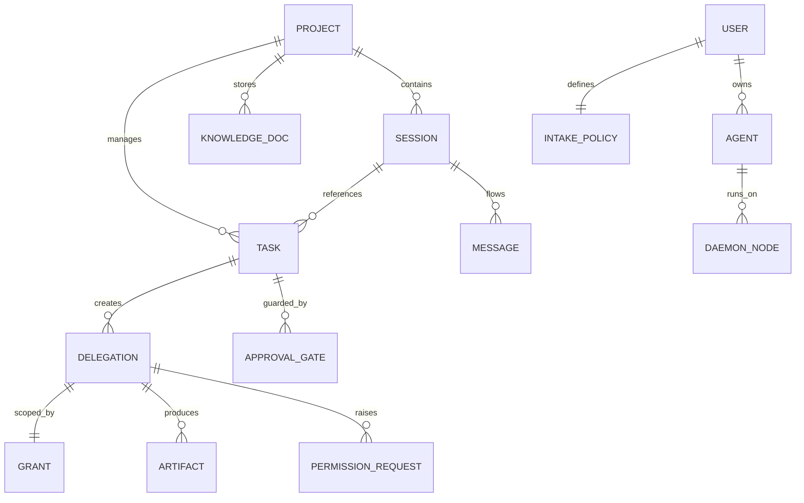
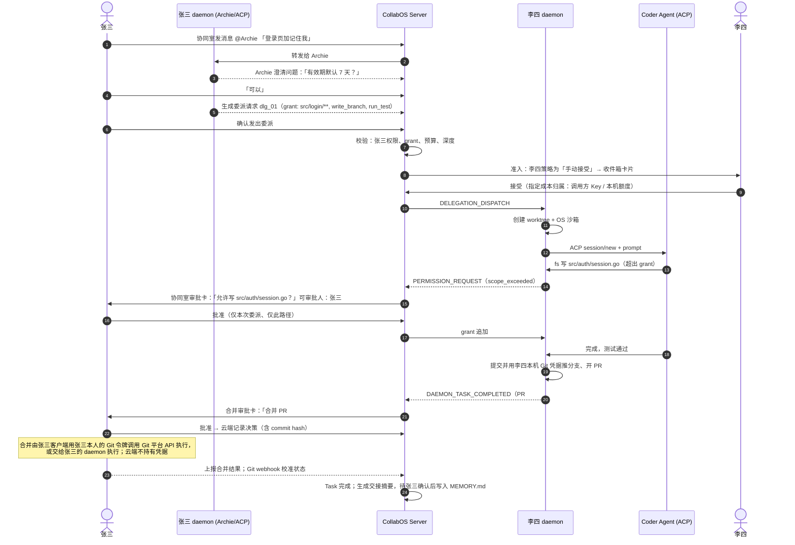
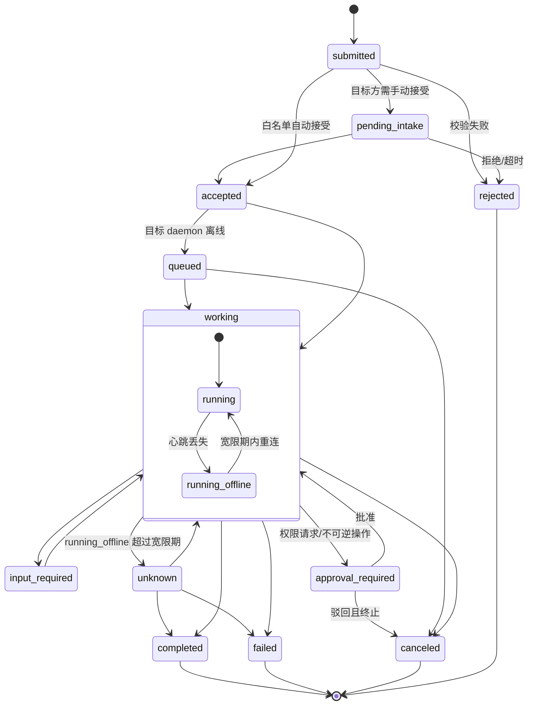

# 多 Agent 跨设备工程协同平台（CollabOS）产品需求文档（PRD）

**版本：** V0.4（评审稿）
**日期：** 2026-10-21
**产品代号：** CollabOS
**产品形态：** 面向小型软件研发团队的会话式多 Agent 工程协同平台
**首期场景：** 小团队软件开发闭环
**核心原则：** 代码与凭据不出开发者机器；跨所有者委派需授权并经目标方同意；不可逆操作显式审批；任务与 Git PR 绑定；共享知识可追溯
**配套文档：** [CollabOS 工程规范 v0.2](./collabos-engineering-conventions.md)、[Multica 调研](../research/multica-report.md)、[OpenUI 调研](../research/openui-report.md)

---

## 0. 版本变更说明

### 0.1 V0.4 变更（本次）

| # | 变更 | 涉及章节 | 说明 |
|---|---|---|---|
| 1 | Runtime 首期只走 ACP | 2.1、7.2.5、6.5 | 删除「stdin/stdout 接管 CLI」方案；Claude Code、Codex 通过 ACP 适配器（如社区 ACP 桥接）接入；保留适配器分层供后续扩展 |
| 2 | 本地 PEP 改为两层、如实表述 | 7.2.4、15、16 | 第一层：daemon 执行 ACP 的 fs/terminal/permission 请求；第二层：操作系统沙箱（Linux Landlock/seccomp，macOS sandbox-exec，Windows 容器或白名单兜底）。删除「100% 拦截」说法，改为可测指标；命令黑名单只作纵深防御 |
| 3 | 合并不由云端执行 | 5.0、6.6、8.4 | 合并由审批人本人的 Git 令牌（客户端发起）或其 daemon 执行；云端只记录决策；代码与凭据不出机 |
| 4 | 跨所有者准入与成本归属 | 6.4、6.1 | 目标 owner 设置准入策略（白名单、每日配额、手动接受）；明确算力与 API Key 的成本归属 |
| 5 | 恢复 V0.2 被 V0.3 删除的内容 | 6.5、16、17 | ACP 能力差距矩阵 + 版本说明；完整风险表；开放问题与 V0.3 合并 |
| 6 | 竞品章节改为以 Multica 为中心 | 1.6 | 删除 HiFox 章节和自评「极佳」表，改为事实对比；注明 Multica 许可证对代码复用的限制 |
| 7 | 状态机统一 | 6.2、8.3 | 合并 V0.3 中 6.2 与 8.3 的两套描述；`running_offline` 定义为 `working` 的子状态，宽限期过后转为 `unknown` |
| 8 | 明确 Chief Agent 宿主与离线行为 | 3.2 | Chief Agent 运行在 owner 本机 daemon 上；owner 离线时的行为写明 |
| 9 | 新增技术栈章节 | 10 | Go 服务端 + daemon、PostgreSQL、sqlc、Chi、React+Vite+TS+shadcn(Radix)+Tailwind token、TanStack Query/Router、Zustand、Tauri、SQLite journal、OpenUI 富消息 |
| 10 | 视觉风格改为占位 | 2.1、13 | 删除「Obsidian 炭黑」定案；暂用 Grok Bot 式中性主题（浅/深），全部样式走 token，可替换 |
| 11 | MVP 收窄为 4–6 周、两台机器 | 14 | 网关集群/NATS、追踪火焰图、知识图谱、性能指标（35MB、50ms、1 万条消息）移到后续阶段，或改为目标值、不作 MVP 门槛 |
| 12 | 行文改为中性 | 全文 | 去掉营销式措辞 |

### 0.2 V0.3 变更回顾
- 确立「会话主干 + 资产抽屉 + 本地 daemon」三层产品结构；
- 新增 Client 端（UI 客户端、本地 daemon）、Server 端、通信协议三个章节；
- 引入 Chief Agent；去掉身份切换开关；
- 审批卡显式展示「谁可以审批」；
- 引入 `MEMORY.md` 团队长期记忆。

### 0.3 V0.2 变更回顾
- 首期场景收敛为小团队软件开发；
- 确认首期 Runtime 只接 ACP，保留适配器分层；
- 新增委派协议（字段、状态机、幂等、权限不扩大、拒绝原因码）；
- 提示注入防护提升为 P0。

---

## 1. 产品概述

### 1.1 产品定位
CollabOS 让不同用户拥有的 Agent，在同一个会话空间里与人一起讨论、委派任务、共享项目上下文、跟踪结果。这些 Agent 可以属于不同项目，运行在不同机器上的 Runtime 里。

平台是**协作中枢和控制面**：
- 不集中存储源码，不托管代码仓库。
- 执行发生在开发者本机的 daemon 中。

平台不要求所有 Agent 使用同一模型或 Runtime，也不要求原生会话与私有记忆上云。

### 1.2 产品愿景
1. **在聊天中协作**：在协同室里用自然语言讨论，@Agent 派活，不需要先填工单。
2. **成果可追溯**：讨论中产生的任务、PR、测试结果归入资产抽屉，与 Git 分支和 PR 状态绑定。
3. **代码留在本机**：代码、凭据、构建脚本留在开发者机器上，执行发生在独立 Git worktree 和操作系统沙箱中。
4. **权责清晰**：不可逆操作（合并主分支、部署）显式列出可审批人，留存审计记录。

### 1.3 产品目标
1. 将用户、团队、项目、Bot、Runtime、会话、任务、共享知识纳入统一管理；
2. 不同 Runtime 通过标准协议（首期 ACP）接入；
3. 支持跨所有者的远程委派，以及在授权范围内进入共享项目延续工作；
4. 真人与多个 Bot 在同一协同室协作，讨论内容可转为结构化任务；
5. Bot 在授权范围内主动推进任务；
6. 项目背景、约定（`MEMORY.md`）、任务交接不因 Runtime 或机器切换而丢失；
7. 控制面在云端（或自托管），计算与代码在本地；
8. 为后续接入新 Runtime、外部 IM、第三方能力预留扩展点。

### 1.4 非目标
- 自研基础大模型；
- 强制统一 Runtime 或模型供应商；
- 强制原生会话和私有记忆上云；
- Bot 默认拥有项目全部权限；
- 云端控制或镜像用户的执行环境与源码；
- 云端持有用户的 Git 凭据或代执行合并；
- 把「能发一条消息」当成任务协作。

### 1.5 产品结构
```
┌───────────────────────────────────────────────────────────────┐
│ 会话主干：协同室消息流、@Agent、行内任务/审批/拦截卡片、Bot 富消息 │
├───────────────────────────────────────────────────────────────┤
│ 资产抽屉：任务与 PR、成员与 Agent 网络、MEMORY.md                 │
├───────────────────────────────────────────────────────────────┤
│ 本地 daemon：ACP 客户端、git worktree、两层 PEP、SQLite journal    │
└───────────────────────────────────────────────────────────────┘
```

### 1.6 竞品分析：Multica

依据 2026-10-21 对 https://github.com/multica-ai/multica 的调研（详见 research/multica-report.md）。

**Multica 概况（已核实）：**
- **定位**：源码公开的团队工作区，把任务像派给同事一样派给 AI 编码智能体，看板 + Issue 为主。
- **规模与活跃度**：约 5.3 万 star；0.x 版本，约每 3–7 天发布一次。
- **架构**：Go 后端（Chi、sqlc、WebSocket）+ PostgreSQL；本地 daemon 拉起 CLI 智能体；客户端为 Next.js Web、Electron 桌面端、Expo 移动端。
- **Runtime 接入**：支持 26 种 CLI；每种 CLI 一个适配器；其中一部分走 ACP（含 Hermes、Kimi、Kiro、Qoder 等），Claude Code、Codex 等走各自的协议。
- **已有能力**：
  - Squads、Skills、Autopilot（cron）、聊天派活；
  - 执行日志回放、用量统计；
  - 「审核中」验收、收件箱；
  - owner/admin/member 角色；
  - 支持 GitHub/GitLab/Gitea；
  - Slack、飞书等 IM 渠道；
  - 自托管（Compose/Helm）+ 云版。

**事实对比：**

| 维度 | Multica | CollabOS（计划） |
|---|---|---|
| 主界面 | 看板 + Issue，Chat 为辅 | 协同室群聊为主，看板在抽屉里 |
| 执行位置 | 本地 daemon | 本地 daemon |
| Runtime 接入 | 26 种 CLI 各自适配，部分走 ACP | 只走 ACP（Claude Code/Codex 经 ACP 适配器） |
| 跨所有者委派 | README 中未见相关描述 | 委派协议：grant 子集、深度、预算、幂等、目标方准入 |
| 审批粒度 | 以结果验收为主（审核中） | 执行中的权限请求审批 + 不可逆操作审批 |
| 提示注入防护 | README 中未见专门机制 | P0：来源标记、指令与数据分离、外部结论待确认 |
| 成熟度 | 已发布产品，社区活跃 | 未开发 |
| 许可证 | Multica License（Apache-2.0 + 附加条件，非 OSI 开源） | 待定 |

**差异化方向：**
1. 跨所有者委派协议：Multica 以单 workspace 内派活为主。
2. 执行中审批 + 注入防护：而不只是事后验收。
3. 群聊为主的多人多 Bot 协作。
4. 以 ACP 标准协议接入，减少逐个 CLI 适配的维护成本。代价是首期覆盖的 Runtime 较少。

**许可证影响：**
- 对外提供托管服务、或嵌入商业产品，需要 Multica 商业许可，免费托管也不例外。
- 不得移除或修改由其 UI 代码衍生的界面上的 Multica 品牌。
- 只使用后端也必须声明 "built on Multica"。
- **因此 CollabOS 不复用 Multica 任何代码**，只参考其公开的工程约定（见工程规范）。

---

## 2. 需求状态与决策原则

| 标记 | 含义 |
|---|---|
| 已确认 | 用户已明确 |
| 建议 | 推荐方案，待实测 |
| 待验证 | 需要实验或调研 |
| 开放问题 | 尚未决策 |

### 2.1 已确认
1. **产品形态**：会话式工程协同平台；用户始终以真实身份登录。
2. **架构**：云端（或自托管）控制面 + 本地 daemon（ACP 客户端、worktree、PEP）。
3. **协作入口**：协同室群聊 + 资产抽屉。
4. **Runtime**：首期**只接 ACP**，不做 stdin/stdout 管道接管；保留适配器分层。
5. **审批**：不可逆操作必须显式列出可审批人。
6. **合并**：云端不执行合并，不持有 Git 凭据。
7. **记忆**：`MEMORY.md` 版本化管理，变更由负责人确认。
8. **技术栈**：见第 10 章与工程规范 ADR-001～006。
9. **视觉**：正式风格暂缓；当前用 Grok Bot 式中性占位主题（浅/深）；所有样式走语义 token，可整体替换。

### 2.2 待验证
- Claude Code、Codex 的 ACP 适配器对权限请求、会话恢复、用量上报的支持程度；
- 各平台操作系统沙箱对 Agent 工具链（node、go、包管理器联网）的兼容性；
- 同一仓库多任务并发时的冲突策略（首期一个任务独占一个 worktree）；
- 弱网下 WebSocket 重连与 journal 补报。

---

## 3. 用户角色与 Agent

### 3.1 用户角色
- **项目负责人**（如张三）：发起需求、确认架构、审批合并、管理项目授权；
- **开发者**（如李四）：托管本机 daemon，接收委派，审查本机上运行的 Agent；
- **测试**（如王五）：运行测试环境与回归任务；
- **团队管理员**：成员、共享策略、配额；
- **平台管理员**：系统运行与安全配置（自托管时为部署方）。

### 3.2 Agent 分层
1. **Chief Agent（每个用户一个，如张三的 Archie）**
   - **宿主**：运行在 owner 自己机器的 daemon 中，经 ACP 连接一个 Runtime；云端只保存其配置和会话事实。
   - **职责**：澄清需求、拆解任务、生成委派请求（委派请求必须由 owner 确认或落在 owner 预设的自动策略内）、汇总进展。
   - **owner 离线时**：
     - Chief Agent 不运行，云端不代为执行任何推理。
     - 已发出的委派照常进行，由目标方 daemon 执行。
     - 需要 owner 决策的事项（澄清、审批）进入 owner 收件箱，委派状态为 `input_required` / `approval_required`，并按超时策略处理（默认超时后暂停，不自动通过）。
     - 协同室中 @离线 Chief 时，显示「宿主离线，已排队」。
   - 二期再评估：可选的云端托管 Chief（需要 owner 提供 API Key，并单独授权）。
2. **专业 Agent（如李四机器上的 Coder Agent）**
   - 运行在其 owner 的 daemon 中，只处理被接受的委派；
   - 受该机器的两层 PEP 约束。

---

## 4. 领域模型



**核心实体：**
- **Session（协同室）**
- **Chief Agent**
- **Daemon Node**：本地守护进程实例
- **Task**
- **Delegation**：跨机委派
- **Grant**：资源、动作、时效
- **Intake Policy**：目标 owner 的准入策略（新增）
- **Permission Request**：执行中越过 grant 的权限请求（新增）
- **Approval Gate**：不可逆操作审批
- **Artifact**：分支、PR、diff、测试报告
- **Memory**：`MEMORY.md` 与经确认的结论

---

## 5. 核心场景

### 5.0 MVP 主流程（两台机器）

示例需求：「登录页增加『记住我』」。张三的机器上运行 Archie，李四的机器上运行 Coder Agent，两人属于不同 owner。



### 5.1 场景 A：越权与拦截
1. Agent 请求读写 grant 以外的路径，或执行 grant 以外的动作；
2. **第一层（daemon）**：ACP 的 `fs/*`、`terminal/*` 请求，以及 `session/request_permission`，由 daemon 对照 grant 判断。超出范围就拒绝，或转为权限请求（`scope_exceeded` / `action_forbidden`）；
3. **第二层（OS 沙箱）**：Agent 进程本身（包括它不经 ACP 直接读写文件、调用子进程的行为）运行在沙箱中，文件系统只能写 worktree 和临时目录，网络按策略放行；
4. 拦截事件上报云端，协同室显示拦截卡片，提供「申请追加授权」入口。

### 5.2 场景 B：跨所有者委派
1. A 的 Chief 检索到 B 注册的 Backend Agent；
2. 平台核验 A 的调用权限、预算、深度；
3. 按 B 的 Intake Policy 处理：白名单内自动接受，有配额则检查当日配额，否则走手动接受；
4. 接受时确定成本归属（见 6.4）；
5. B 的 daemon 执行，提交 PR，通知 A 审查。

### 5.3 场景 C：进入共享项目
开发者加入项目 → 本机 daemon 配对 → 继承 `MEMORY.md` → 用自己的 Chief 直接派活。

### 5.4 场景 D：Agent 主动推进（二期）
测试 Agent 在定时回归中发现接口延迟上升，在协同室发帖并附上日志；经负责人确认后转为任务。

### 5.5 场景 E：离线与恢复
1. daemon 失去心跳，节点标记为 `offline`，进行中的委派进入 `working/running_offline`；
2. 本地任务继续执行，日志写入 SQLite journal；
3. 宽限期（默认 10 分钟，可配置）内重连：按 `ack_seq` 补报，状态恢复为 `working` 或终态；
4. 超过宽限期仍未重连：转为 `unknown`，通知委派方；重连后依据 journal 校准为 `completed` / `failed` / `working`。

---

## 6. 业务规则与委派协议

### 6.1 委派请求

```json
{
  "delegation_id": "dlg_01J9X882A",
  "idempotency_key": "task_12:impl:v1",
  "parent_task_id": "task_12",
  "source": { "project": "proj_web", "bot": "archie_zhangsan", "owner": "user_zhangsan" },
  "target": { "bot": "coder_lisi", "owner": "user_lisi" },
  "on_behalf_of": { "type": "user", "id": "user_zhangsan" },
  "goal": {
    "summary": "登录页增加记住我，默认 7 天",
    "acceptance": ["新增单测通过", "原登录接口兼容"]
  },
  "context_bundle": [
    { "type": "memory", "ref": "MEMORY.md#auth-rules", "trust": "confirmed" },
    { "type": "message", "ref": "msg_902", "trust": "user_input" }
  ],
  "grant": {
    "resources": ["repo:web/src/login/**", "repo:web/tests/login/**"],
    "actions": ["read", "write_branch", "run_test", "open_pr"],
    "network": ["registry.npmjs.org"],
    "expires_at": "2026-10-22T18:00:00+08:00",
    "issuer": "user_zhangsan"
  },
  "budget": { "max_cost_units": 50, "max_duration_min": 30 },
  "billing": { "compute": "target", "model_key": "source" },
  "depth": 1,
  "max_depth": 3,
  "approval_policy": {
    "require": ["merge_protected", "deploy"],
    "eligible_approvers": [{ "id": "user_zhangsan", "name": "张三", "role": "项目负责人" }],
    "rule": "ANY_ONE"
  }
}
```

### 6.2 统一状态机（取代 V0.3 中 6.2 与 8.3 两处描述）



规则：
- `running_offline` 是 `working` 的子状态，对外展示为「执行中（宿主离线）」；
- `unknown` 表示平台无法确认结果，绝不当作成功处理；
- 每次状态转换持久化记录：时间、上报方、事件、`seq`；
- 终态不可逆；重试会生成新的委派，使用新的幂等键后缀。

### 6.3 权限不扩大与原因码
子委派的 grant 必须是父委派 grant 的子集（资源、动作、网络、时效都不能扩大）。

| 原因码 | 含义 | 处理 |
|---|---|---|
| `unauthorized` | 无权调用目标 Bot | 拒绝 |
| `intake_denied` | 目标方拒绝，或不在白名单 | 拒绝，通知调用方（新增） |
| `quota_exceeded` | 目标方每日配额用尽 | 拒绝或排队至次日（新增） |
| `scope_exceeded` | 路径超出 grant | daemon 拒绝，或转为权限请求 |
| `action_forbidden` | 动作超出 grant | daemon 拒绝，或转为权限请求 |
| `sandbox_denied` | OS 沙箱阻止（未经 ACP 的访问） | 记录并上报，不可在线追加（新增） |
| `budget_exceeded` | 预算用尽 | 暂停，等待审批扩容 |
| `depth_exceeded` | 超过 max_depth | 拒绝 |
| `duplicate` | 幂等键重复 | 返回原委派 |

### 6.4 跨所有者准入与成本归属（新增）
**Intake Policy**：每个 owner 对自己的每个 Agent 设置准入策略。
- **模式**：`manual`（默认，逐个接受）、`allowlist`（名单内的用户、团队、项目自动接受，其余转为手动）、`closed`（不接受外部委派）。
- **配额**：每日最大委派数、每日最大成本单位、同时执行数。
- **约束**：可接受的最大 grant 范围（如只允许 `read`、`write_branch`）、禁止 `network` 外连、最长执行时长。
- **审计**：接受或拒绝都记录在双方的审计日志里。

**成本归属**（`billing` 字段，接受时由目标方确认）：

| 成本项 | 可选 | 默认 |
|---|---|---|
| 本机算力（CPU、时长） | 目标方承担 | 目标方承担（受配额限制） |
| 模型 API Key | `source`：调用方 Key，经 daemon 本地注入，Key 不经云端存储；`target`：目标方 Key | `target` 需目标方明确同意，否则为 `source` |
| 记账 | 平台按委派记录用量（Agent 自报 + 适配器计量），双方可见 | — |

平台内结算属于开放问题（17.1），首期只记账、不结算。

### 6.5 ACP 接入与能力差距（恢复自 V0.2，更新）
**已确认**：首期只接 ACP。Claude Code、Codex 通过 ACP 适配器接入（适配器的具体实现与版本在阶段 0 选定并实测）。

**适配器分层**：平台核心只依赖一组「Runtime 能力接口」（会话、输入、事件流、取消、状态、产物、权限请求、健康、能力声明）。ACP 适配器负责映射；以后接入 A2A 或其他协议时新增适配器，不改领域模型。

> **版本说明**：**已定对接 ACP v2**。据 agentclientprotocol.com 初步核查：ACP 基于 JSON-RPC 2.0。v1 到 v2 有破坏性变更：会话恢复由 `session/load` 改为 `session/resume`，`authenticate` 改为 `auth/login`，权限请求结构也有变化。委派元数据、成本、富消息等通过 `_meta` 扩展携带。

| 平台需要的能力 | ACP 可能的对应 | 初步判断 | 平台补齐方式 |
|---|---|---|---|
| 建会话 / 发送输入 | session/new、prompt | 直接对应 | — |
| 流式进度 | session/update | 直接对应 | 适配器转为平台事件 |
| 取消 | session/cancel | 直接对应 | 记录取消原因 |
| 权限请求 | session/request_permission | 对应，粒度待验证 | 接入 PEP 第一层与审批引擎 |
| 文件、终端访问 | client 侧 fs/*、terminal/* | 对应（取决于 Agent 是否走这些接口） | daemon 实现并对照 grant 执行；不走这些接口的访问由 OS 沙箱兜底 |
| 会话恢复 | session/load 或 session/resume（可选能力） | 取决于 Agent | 不支持时走上下文交接 |
| 能力声明 | initialize 协商 | 部分对应 | 平台补业务能力描述 |
| 任务级状态 | 无 | 需补齐 | 委派状态机（6.2） |
| 跨所有者身份授权 | 无 | 需补齐 | grant + 准入 + daemon 校验 |
| 预算 / 成本 | 无标准字段 | 需补齐 | 适配器计量 + `_meta` 自报 |
| 健康 / 在线 | 无 | 需补齐 | daemon 心跳 |
| 富消息 UI | 无 | 需补齐 | `_meta.collabos.ui`（OpenUI Lang，见 7.1.5） |

**验收**：区分「Runtime 未实现能力」与「执行失败」；Runtime 异常不导致平台状态失真；新增 Runtime 时不改核心模型。

### 6.6 合并与不可逆操作（新增）
- **审批类别**：`merge_protected`、`push_main`、`deploy_*`、`db_migration` 默认需要审批。
- **执行方**：
  1. 审批人客户端用**审批人本人的 Git 令牌**调用 Git 平台 API 合并（令牌存在系统钥匙串里，不上传）；或
  2. 交给审批人自己的 daemon 执行。
  - 云端**不执行合并**，也不持有任何 Git 凭据。
- **云端职责**：记录决策（审批人、时间、决策、理由、被批准的 commit hash），并在执行前校验 PR 头 commit 与批准时一致。不一致需要重新审批。
- **结果校准**：执行结果由执行方上报，并用 Git webhook 校准；若不一致，以 Git 平台状态为准。

---

## 7. Client 端需求

### 7.1 Web / 桌面客户端
#### 7.1.1 会话主视窗
- **FR-CLI-101**：消息列表虚拟滚动（目标值见 12.1，不作 MVP 门槛）；
- **FR-CLI-102**：GFM Markdown、代码高亮、diff（逐行/分栏）、Mermaid；
- **FR-CLI-103**：@ 联想，区分本人 Chief、他人 Agent（显示 owner 与设备）、人类成员；
- **FR-CLI-104**：行内任务卡：宿主机器、耗时、阶段、用量、可展开的日志；
- **FR-CLI-105**：交付物入口：PR、diff、报告。

#### 7.1.2 资产抽屉
- **FR-CLI-201**：可收起，状态本地持久化；
- **FR-CLI-202**：成员与 Agent 网络：区分我的和他人的 Agent，显示在线状态、准入策略摘要；
- **FR-CLI-203**：任务与 PR：编号、分支、测试结果、合并状态、diff 预览；
- **FR-CLI-204**：`MEMORY.md` 预览与引用。

#### 7.1.3 审批卡
- **FR-CLI-301**：
  - 展示审批目标（如「合并 PR #12 到 main」「允许写 src/auth/session.go」）；
  - 展示可审批人姓名与角色，以及规则（ANY_ONE / ALL）；
  - 展示来源（哪个 Bot、哪个 owner、内容可信级别）。
- **FR-CLI-302**：当前用户在名单内时显示「批准 / 驳回」，否则只显示「催办」。**界面状态只是提示，权限以服务端校验为准**。
- **FR-CLI-303**：驳回必须填写理由；
- **FR-CLI-304**：做出决定后转为只读审计展示；
- **FR-CLI-305**：合并类审批批准后，由客户端发起合并（使用本人 Git 令牌），或提示交给本人 daemon（见 6.6）。

#### 7.1.4 连接与缓存
- **FR-CLI-401**：本地缓存最近会话和任务快照（Web 用 IndexedDB，桌面端同样适用）；
- **FR-CLI-402**：断线时显示提示；指数退避重连（1s→30s）；重连后增量同步。

#### 7.1.5 Bot 富消息（新增）
- Bot 可通过 OpenUI Lang 渲染**白名单组件**：表单、表格、图表、清单、选项、代码块、提示框；
- **平台卡片**（审批、任务、委派、diff）**只能由服务端结构化消息生成**，Bot 无法伪造；
- **传输**：ACP 消息 `_meta.collabos.ui`；正文保留纯文本降级内容；服务端校验后存储；
- **交互回流**：
  - 按钮、表单等交互统一调用服务端接口，以**点击者身份**鉴权，高风险操作转入审批；
  - 回流给 Bot 的内容按「用户输入」可信级别处理；
- **禁止**：HTML/iframe 组件、外链图片直连（必须经服务端代理）、高频自动刷新；
- 每条富消息标注来源 Bot 与 owner。

### 7.2 本地 daemon
#### 7.2.1 形态
- **FR-DAE-101**：Go 单二进制，支持 macOS (arm64/x64)、Linux (x64/arm64)、Windows (x64)；
- **FR-DAE-102**：两种分发形态（ADR-005）：Tauri sidecar，以及独立安装（Homebrew/脚本/系统服务）。单机只运行一个实例；
- **FR-DAE-103**：资源占用目标值见 12.1（不作 MVP 门槛）；可配置单任务的 CPU 与内存上限。

#### 7.2.2 环境探测
- **FR-DAE-201**：探测 git、ACP 可用的 Agent（及其适配器）、常用工具链；
- **FR-DAE-202**：上报能力清单。

#### 7.2.3 Worktree 沙箱
- **FR-DAE-301**：每个委派一个 worktree（`<data>/worktrees/<delegation_id>`，分支 `collabos/<task>-<short>`），不触碰开发者当前的工作区；
- **FR-DAE-302**：worktree 使用独立 git 身份；测试在 worktree 内运行；提交附 `Delegation-Id` trailer；用**本机 owner 的 Git 凭据**推送并开 PR（需要 grant 含 `open_pr`）；
- **FR-DAE-303**：结束后回收 worktree；定期 GC。

#### 7.2.4 本地 PEP（两层）
- **第一层：ACP 请求执行**
  - daemon 作为 ACP client，实现 `fs/read_text_file`、`fs/write_text_file`、`terminal/*`，并处理 `session/request_permission`；
  - 路径一律规范化（解析符号链接、`..`），对照 `grant.resources` 判断；命令对照 `grant.actions` 判断；
  - 超出范围时，拒绝或转为权限请求（6.3）。
- **第二层：操作系统沙箱**
  - Agent 进程及其子进程运行在沙箱中，用于兜底那些不经 ACP、直接调用系统的访问：
    - **Linux**：Landlock（文件系统）+ seccomp（系统调用），可选网络命名空间；
    - **macOS**：sandbox-exec 配置文件（该机制已被 Apple 标为弃用但仍可用，需持续跟踪）；
    - **Windows**：首期用容器（如 WSL2/Docker）或「受限用户 + 目录白名单」兜底，能力弱于前两者，界面上如实标注。
  - 允许写的范围：worktree、临时目录、工具缓存；网络按 `grant.network` 放行。
  - 沙箱不可用时，daemon 拒绝接受外部 owner 的委派；本人委派可在明确提示后继续执行。
- **命令黑名单**（`rm -rf /`、`mkfs`、`sudo` 等）**只作纵深防御**，不当作主要安全机制。
- **局限（如实说明）**：
  - 第一层只能看到经 ACP 发起的操作；
  - 第二层受各操作系统能力限制；
  - 网络外泄、在 worktree 内写恶意代码等风险不能被完全拦截，需要依靠审批、代码评审和最小 grant。
- **FR-DAE-403**：拦截事件即时上报（含层级：`acp` / `sandbox`）。

#### 7.2.5 Runtime 适配层
- **FR-DAE-501**：只走 ACP。daemon 以 ACP client 身份启动 Agent（或其 ACP 适配器）进程，管理会话生命周期；
- **FR-DAE-502**：将 `session/update` 转为平台事件；
- **FR-DAE-503**：用量取自 Agent 上报或 `_meta`；取不到时标注「未知」，不估算冒充；
- 不做 stdin/stdout 文本解析式接管。

#### 7.2.6 本地 journal
- **FR-DAE-601**：SQLite（纯 Go 驱动）记录事件、阶段、ACP 游标、待上报终态；
- **FR-DAE-602**：断网时本地任务继续执行；需要审批的步骤暂停等待；
- **FR-DAE-603**：重连后按 `ack_seq` 补报，用幂等键防止重复。

---

## 8. Server 端需求

### 8.1 接入与实时
- **FR-SRV-101**：
  - **UI 通道**：短期访问令牌 + 刷新；
  - **daemon 通道**：设备令牌（配对生成，可吊销）。
- **FR-SRV-102**：心跳 15s，连续 3 次丢失判定 `offline`，进行中的委派进入 `running_offline`，宽限期 10 分钟后转为 `unknown`（6.2）。
- **FR-SRV-103**：
  - **MVP**：单实例 Go 服务内存 hub 广播；
  - **后续**：多实例经 Redis 或 NATS 中继（阶段 2+）。

### 8.2 会话与上下文
- **FR-SRV-201**：消息存 PostgreSQL，每个协同室单调 `seq`；
- **FR-SRV-202**：`client_msg_id` 幂等（MVP 存 PostgreSQL 唯一约束，不强依赖 Redis）；
- **FR-SRV-203**：上下文打包：相关消息、`MEMORY.md`、仓库元数据。每段带可信级别，不可信内容用明确的边界标签包裹（11.2）。

### 8.3 任务与委派引擎
- **FR-SRV-301**：实现 6.2 的统一状态机，状态转换只能由服务端写入；
- **FR-SRV-302**：路由委派；执行准入策略（6.4）；目标 daemon 离线时进入 `queued`，并在协同室提示；
- **FR-SRV-303**：GitHub/GitLab webhook 校准 PR 状态。

### 8.4 审批与策略引擎
- **FR-SRV-401**：不可逆操作清单（6.6）+ 执行中权限请求（6.3）统一进入审批；
- **FR-SRV-402**：服务端校验审批人身份是否在名单内，否则返回 403；来自不可信来源的内容触发的操作必须审批；
- **FR-SRV-403**：只追加审计日志，记录审批人、时间、决策、理由、commit hash；
- **FR-SRV-404**：**不执行合并、不存储 Git 凭据**；只记录决策并校验执行结果。

### 8.5 记忆
- **FR-SRV-501**：委派完成后生成交接摘要（由 owner 的 Chief 或配置的模型生成），状态为「待确认」；
- **FR-SRV-502**：`MEMORY.md` 版本化，变更需负责人确认。
- 知识图谱移到阶段 3。

### 8.6 成本与可观测
- **FR-SRV-601**：团队、用户、委派三级预算；90% 警告，100% 暂停；
- **FR-SRV-602**：`trace_id` 贯穿 UI → Server → daemon → ACP → PR → 审批，可按 trace_id 查询事件列表；
- 火焰图与拓扑可视化移到阶段 2+。

---

## 9. 通信协议与接口

### 9.1 WebSocket 帧

```typescript
interface Envelope<T = unknown> {
  type: string;
  trace_id: string;
  msg_id: string;     // 发送方生成，用于幂等
  seq?: number;       // 服务端下行单调序号
  ack_seq?: number;   // daemon 上行确认
  timestamp: string;  // ISO 8601
  payload: T;
}
```
类型定义的来源是 Go `server/pkg/protocol`，由 tygo 生成 TS 类型（工程规范 ADR-003）。

| 事件 | 方向 | 说明 | 关键字段 |
|---|---|---|---|
| `CLIENT_HANDSHAKE` / `SERVER_HANDSHAKE_ACK` | 双向 | 握手 | client_type, token, capabilities / session_id, heartbeat_interval |
| `CHAT_SEND_MESSAGE` | UI→S | 发消息 | session_id, text, mentions, client_msg_id |
| `CHAT_BROADCAST_MESSAGE` | S→UI | 广播 | message_id, sender, text, rich?, card? |
| `INTAKE_REQUEST` / `INTAKE_DECISION` | S↔UI | 目标方准入 | delegation_id, decision, billing（新增） |
| `DELEGATION_DISPATCH` | S→D | 下发 | delegation_id, goal, grant, budget |
| `DAEMON_PROGRESS_STREAM` | D→S | 进度 | delegation_id, step, chunk, usage |
| `PERMISSION_REQUEST` / `PERMISSION_DECISION` | D↔S | 执行中权限请求 | delegation_id, resource, action, layer（新增） |
| `GRANT_UPDATE` | S→D | 追加授权 | delegation_id, grant_delta（新增） |
| `DAEMON_POLICY_BLOCKED` | D→S | 拦截上报 | delegation_id, code, layer, target |
| `DAEMON_TASK_COMPLETED` | D→S | 完成 | delegation_id, pr_url, diff_stat, tests, usage |
| `APPROVAL_TRIGGER` / `APPROVAL_SUBMIT` | S↔UI | 审批 | approval_id, eligible_approvers, rule / decision, comment |
| `MERGE_RESULT` | UI/D→S | 合并执行结果 | approval_id, commit, result（新增） |
| `HEARTBEAT_PING/PONG` | 双向 | 保活 | — |

### 9.2 REST 路由（MVP 子集）
```
POST   /api/v1/auth/login | /auth/refresh
GET    /api/v1/me
GET    /api/v1/sessions             POST /api/v1/sessions
GET    /api/v1/sessions/{id}/messages?cursor=
POST   /api/v1/daemons/pair         GET /api/v1/daemons    DELETE /api/v1/daemons/{id}
GET    /api/v1/agents/{id}/intake-policy   PUT /api/v1/agents/{id}/intake-policy
GET    /api/v1/intake/pending       POST /api/v1/intake/{delegation_id}/decide
GET    /api/v1/tasks                GET /api/v1/tasks/{id}  POST /api/v1/tasks/{id}/cancel
GET    /api/v1/approvals/pending    POST /api/v1/approvals/{id}/decide
POST   /api/v1/approvals/{id}/merge-result
POST   /api/v1/richmsg/actions      # Bot 富消息交互回流，服务端鉴权
GET    /api/v1/projects/{id}/memory PUT /api/v1/projects/{id}/memory
```
- 错误体统一为 `{ "error": "...", "code": "..." }`；
- 工作区通过 `X-Workspace-ID` 选择（工程规范 3.2、3.3）。

---

## 10. 技术栈（新增）

| 层 | 选型 | 说明 |
|---|---|---|
| 服务端 | Go、Chi、pgx/v5、sqlc、golang-migrate、log/slog | 单一 Go module；handler/service 分层 |
| 数据库 | PostgreSQL | 不建外键、不做级联，由应用层维护；所有业务表带 workspace_id |
| 实时 | gorilla/websocket（或同类库）内存 hub | 多实例中继在阶段 2+ |
| daemon | Go（与服务端同仓库）、ACP client、git worktree、OS 沙箱、SQLite journal（纯 Go 驱动） | 双形态分发 |
| Web | React + Vite + TypeScript + TanStack Router | SPA |
| UI | shadcn/ui（Radix）+ Tailwind v4，**全部样式经语义 token** | 主题文件可替换；lint 禁止裸色值和任意值 |
| 状态 | TanStack Query（服务端数据）+ Zustand（客户端状态） | WS 事件只用于刷新缓存 |
| 校验 | zod（响应解析带兜底） | 兼容新旧客户端与服务端 |
| 桌面端 | Tauri 2 | Rust 侧只做窗口、托盘、通知、钥匙串、sidecar |
| 富消息 | OpenUI（`@openuidev/react-lang`，MIT） | 白名单组件；`_meta` 传输；平台卡片只能由服务端生成；交互经服务端鉴权 |
| 类型共享 | tygo（Go→TS） | 协议类型的来源在 Go 侧 |
| 测试 | go test、Vitest、Playwright | 默认测试不调用真实 Agent |

详细约定见 [工程规范](./collabos-engineering-conventions.md)。

---

## 11. 数据与安全

### 11.1 数据分层
- **平台管理层**：用户、团队、项目、Bot、daemon 节点、授权、准入策略；
- **协作事实层**：任务、委派、权限请求、审批、事件、产物索引、用量；
- **共享知识层**：`MEMORY.md`、已确认结论、交接摘要（带来源与状态）；
- **本地层**：源码、Git 凭据、模型 Key、Runtime 原生会话与记忆，**不出机**。

### 11.2 同步原则
- 每类数据有明确的权威来源；
- 区分已发送、已接收、已执行、已确认；
- 处理重复、乱序、超时；
- 无法确认的状态标为 `unknown`。

### 11.3 权限检查
- **检查维度**：发起者、Bot 及其 owner、代表主体、来源与目标项目、资源与动作、grant 有效期、委派链、目标方准入、Runtime 能力、是否需要审批、预算。
- **执行位置**：在服务端与 daemon 执行，不依赖前端。

### 11.4 不可信内容与提示注入（P0）
- **来源标记**：每段上下文带来源与可信级别（人工确认 / 自动生成 / 外部 Bot / 外部网页）；
- **不可越权触发**：来自不可信来源的内容不能直接触发需要审批的操作；
- **指令与数据分离**：传给 Runtime 时区分任务指令与参考数据；
- **知识入库隔离**：外部 Bot 的结论默认「待确认」；
- **可追溯与回滚**：污染知识可查到所有引用方，并批量标记；
- **Bot 富消息**：Bot 富消息及其交互回流的内容按不可信内容处理（7.1.5）。

---

## 12. 非功能需求
- **可靠性**：
  - 任务状态在服务端持久化；
  - 重试不重复执行不可逆操作；
  - 支持超时、取消、恢复。
- **可观测**：
  - Bot/daemon 可用性、委派链、用量可见；
  - 区分平台故障、连接故障、Runtime 失败。
- **易用性**：
  - 能看到任务交给了谁、进展、阻塞、PR 和测试结果；
  - 审批卡说明谁可以批、批的是什么、影响是什么。
- **可扩展**：新增 Runtime 适配器不改领域模型。

### 12.1 性能目标（目标值，不作为 MVP 验收门槛）
| 项 | 目标 | 阶段 |
|---|---|---|
| daemon 空闲内存 | < 35 MB，CPU < 0.5% | 阶段 2 优化 |
| 协同室消息扇出 | 同实例 P95 < 50ms；多实例另定 | 阶段 2 |
| 长消息列表 | 1 万条消息滚动无明显掉帧 | 阶段 2 |

---

## 13. 信息架构与视觉

```
┌──────────────┬──────────────────────────────┬────────────────────┐
│ 导航栏        │ 协同室消息流                  │ 资产抽屉（可收起）  │
│ · 我的 Chief  │ · 顶栏：协同室名、连接状态     │ [成员与 Agent]      │
│ · 协同室列表  │ · 消息、任务卡、审批卡、拦截卡 │ [任务与 PR]         │
│ · 1 对 1 对话 │ · Bot 富消息                  │ [MEMORY.md]         │
│ · daemon 状态 │ · 输入栏（@ 联想、附件）       │                    │
└──────────────┴──────────────────────────────┴────────────────────┘
```

**视觉**：
- 正式风格暂缓决定。
- 当前用 Grok Bot 式中性占位主题：干净、中性、现代的助手应用风格，浅色与深色两套。
- 所有颜色、圆角、间距、字体、阴影只通过语义 token 使用（工程规范 2.5），换风格 = 替换主题文件。

---

## 14. MVP 与路线图

### 阶段 0：可行性验证（1–2 周，可与阶段 1 前半段重叠）
- 选定并实测 Claude Code、Codex 的 ACP 适配器：会话、流式输出、fs/terminal、权限请求、取消、用量；
- 三个平台的 OS 沙箱 PoC（Linux Landlock 优先）；
- OpenUI 在 Vite 中渲染白名单组件的 PoC。

### 阶段 1：MVP（4–6 周，两台机器、两个 owner）
**唯一验收流程**（5.0）：

```
协同室请求 → 委派给另一 owner 的 Bot → 目标 daemon 准入接受 → worktree 内 ACP 执行
→ 越权触发权限请求并审批 → 开 PR → 指定审批人批准 → 由审批人侧执行合并 → 状态校准
```

**范围**：
- **服务端**：
  - 账号/工作区；
  - 协同室消息（单实例 hub）；
  - 任务与委派状态机（6.2）；
  - 准入策略（manual + allowlist + 日配额）；
  - 权限请求与审批；
  - 审计日志；
  - GitHub webhook。
- **daemon**：
  - 配对、心跳、ACP client（fs/terminal/permission）；
  - worktree；
  - Linux 与 macOS 沙箱（Windows 仅支持本人委派，标注为受限）；
  - journal 与补报。
- **客户端**：Web 优先（Tauri 壳可选），协同室、任务卡、审批卡、准入卡、抽屉中的任务与 PR。
- **合并**：审批人客户端用本人 GitHub 令牌合并。

**不在 MVP**：
- Bot 富消息（OpenUI）；
- 多实例网关、NATS/Redis；
- 追踪火焰图；
- 知识图谱；
- 自动 MEMORY 提取（MVP 只做手动编辑）；
- 外部 IM；
- 性能指标门槛。

### 阶段 2：协作与自治增强
- **能力**：
  - Bot 富消息（OpenUI 白名单）；
  - 多级委派；
  - 自主等级；
  - Agent 主动推进（场景 D）；
  - 交接摘要 → MEMORY 待确认流程；
  - daemon 执行合并。
- **基础设施**：多实例中继；追踪可视化；性能目标；Windows 沙箱加强。

### 阶段 3：生态
- 公开 API/SDK、委派协议文档化（对齐 A2A）；
- 外部 IM（飞书、Slack、钉钉）；
- 企业审计；
- 知识图谱；
- 平台内结算（如有）。

---

## 15. 成功指标（MVP 可测）
- **流程**：5.0 流程在两台机器上端到端跑通率；从发出委派到目标方接受的中位耗时。
- **状态一致性**：任务状态与 Git PR 实际状态不一致的次数（以 webhook 校准对比）；`unknown` 状态的发生率及最终解决率。
- **安全**：
  - 越权测试集（路径穿越、符号链接、grant 外写入、子进程直接写文件、外连网络）中，第一层与第二层分别的拦截率，按平台逐项报告，**不宣称 100%**；
  - 未经审批执行的不可逆操作次数（目标为 0，靠审计核查）；
  - 云端存储的 Git 凭据数量（必须为 0）。
- **成本**：用量记录有归属的委派占比；用量未知的委派占比。

---

## 16. 风险与应对（合并 V0.2 与 V0.3）

| 风险 | 影响 | 应对 |
|---|---|---|
| ACP 规范变动或能力不足 | 适配器返工；状态、授权、成本缺失 | 适配器隔离版本；缺失能力由委派协议承载；兼容测试；保留其他协议的扩展点 |
| Claude Code/Codex 的 ACP 适配器不完整或不稳定 | MVP 主流程受阻 | 阶段 0 实测选型；必要时向上游提交修复或自行维护适配器；适配器版本固定 |
| Agent 绕过 ACP 直接访问系统 | 第一层拦截失效 | OS 沙箱第二层；沙箱不可用时拒绝外部委派 |
| OS 沙箱跨平台能力不一致（macOS 机制已弃用、Windows 较弱） | 安全承诺打折 | 按平台如实标注能力；Windows 首期限制；跟踪替代方案 |
| 网络外泄或在 worktree 内写恶意代码 | 沙箱无法完全阻止 | 最小 grant 与网络白名单；代码评审；合并审批 |
| Runtime 接口差异大 | 无法统一接入与恢复 | 首期只接 ACP；能力分级与兼容矩阵 |
| 原生会话不可迁移 | 无法无缝延续 | 上下文交接作为独立能力 |
| 权限模型过粗 | 泄露或越权 | 读、改、委派、执行、审批分开；权限不扩大 |
| 提示注入与知识投毒 | 越权操作、错误结论扩散 | 11.4 全部措施 |
| Bot 富消息伪造平台卡片或钓鱼 | 误批准 | 平台卡片只能由服务端生成；来源标注；交互经服务端鉴权 |
| Bot 循环委派 | 成本失控 | 深度、预算、时长、并发限制 |
| 跨所有者成本归属不清或被滥用 | 滥用他人算力，商业模式不成立 | 准入策略 + 日配额 + billing 字段 + 双方可见的记账 |
| 合并执行方不一致或凭据泄露 | 越权合并 | 云端不持凭据；审批绑定 commit hash；以 Git 平台状态为准 |
| 平台与 Runtime 状态不一致 | 追踪失真 | seq、校准、`unknown` 状态 |
| 开发者机器断网 | 执行中断或状态丢失 | 本地继续执行 + journal + 宽限期 |
| 混合部署网络复杂 | 连接不稳定 | daemon 主动外连、心跳、退避重连 |
| 聊天刷屏淹没交付物 | 成果难找 | 资产抽屉关联任务与 PR |
| 越权审批或无人负责 | 合规风险 | 显式审批人名单，服务端校验，审计 |
| 与 Multica 同质化 | 缺乏选择理由 | 聚焦跨所有者委派、执行中审批与注入防护、群聊协作（1.6） |
| 误用 Multica 代码 | 许可证违规 | 禁止复制其代码，只参考公开约定；代码评审时检查 |
| 第一版范围过大 | 周期失控 | MVP 只验收 5.0 一条流程 |

---

## 17. 开放问题（合并 V0.2 与 V0.3）

**17.0 已决事项（2026-10-21）**
- ACP 锁定 v2；
- Intake Policy 默认 `manual`；
- 认可的三项取舍：
  1. MVP 先做 Web，Tauri 壳可选；
  2. Windows 首期只允许本人委派（不接受外部 owner 委派）；
  3. 消息幂等不依赖 Redis，用 PostgreSQL 唯一约束。


**17.1 定位与商业**
- 首期以 SaaS、自托管还是两者并行发布？
- 团队与企业是否分不同套餐？
- 跨所有者使用目标方算力或 Key 时，是否需要平台内结算？（首期只记账）

**17.2 Agent 身份与共享**
- 一个 Bot 是否允许关联多个 daemon 或 Runtime 实例？
- Bot 能力由维护者声明，还是由平台测试验证？
- ~~Intake Policy 默认值~~ **已定（2026-10-21）：默认 `manual`（逐个手动接受）**；团队成员是否默认进白名单仍待定。
- 共享项目是否允许外部团队写入任务和知识？
- 是否提供云端托管 Chief（owner 离线时也能澄清）？

**17.3 会话与上下文**
- 原生会话接续支持到什么程度？
- ~~ACP 首期锁定 v1 还是 v2~~ **已定（2026-10-21）：ACP v2**（`session/resume`、`auth/login`、v2 权限请求结构）；首期必须支持哪些能力在阶段 0 后确定。
- `MEMORY.md` 自动提取是否必须负责人二次确认？（建议：必须）
- 用户能否查看 Bot 用了哪些共享知识？

**17.4 自主执行与并发**
- 默认自主等级？
- 哪些操作必须人工审批（6.6 默认清单是否足够）？
- 预算层级：全局、项目、Bot？
- 主动发现的触发条件与通知策略？
- 同一模块被多个 Agent 同时修改时的冲突退避策略？

**17.5 数据与部署**
- 哪些数据必须留在本地（11.1 是否完整）？
- 消息、事件、审计的保留期？
- 产物由平台存储还是放在外部 Git 平台？
- Windows 沙箱首期采用哪种方案？（调研见 research/sandbox-report.md）

**17.6 生态**
- 公开 API/SDK 的时间点？
- 外部 IM 在哪个阶段接入？
- 委派协议是否独立发布，或对齐、贡献给 A2A？

---

## 18. 下一步
1. 评审本稿，并确认 17 章中仍影响 MVP 的问题：Windows 沙箱方案（ACP v2 与 Intake 默认值已定）；
2. 阶段 0 三项 PoC（ACP 适配器、OS 沙箱、OpenUI），产出实测版能力差距矩阵；
3. 按工程规范初始化仓库，开始阶段 1。
